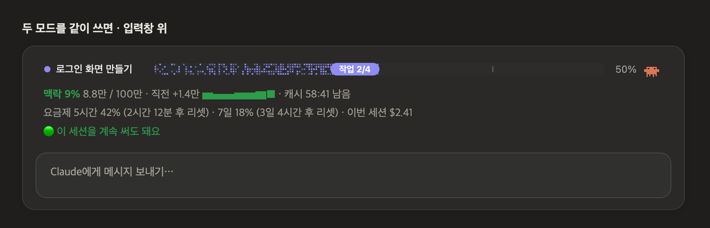
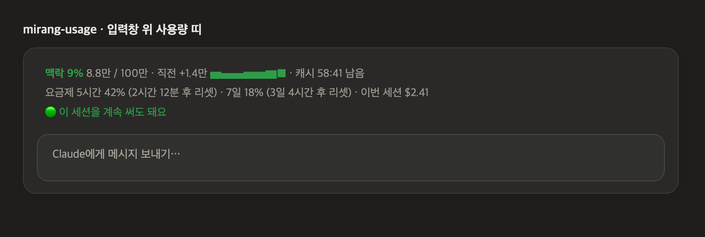
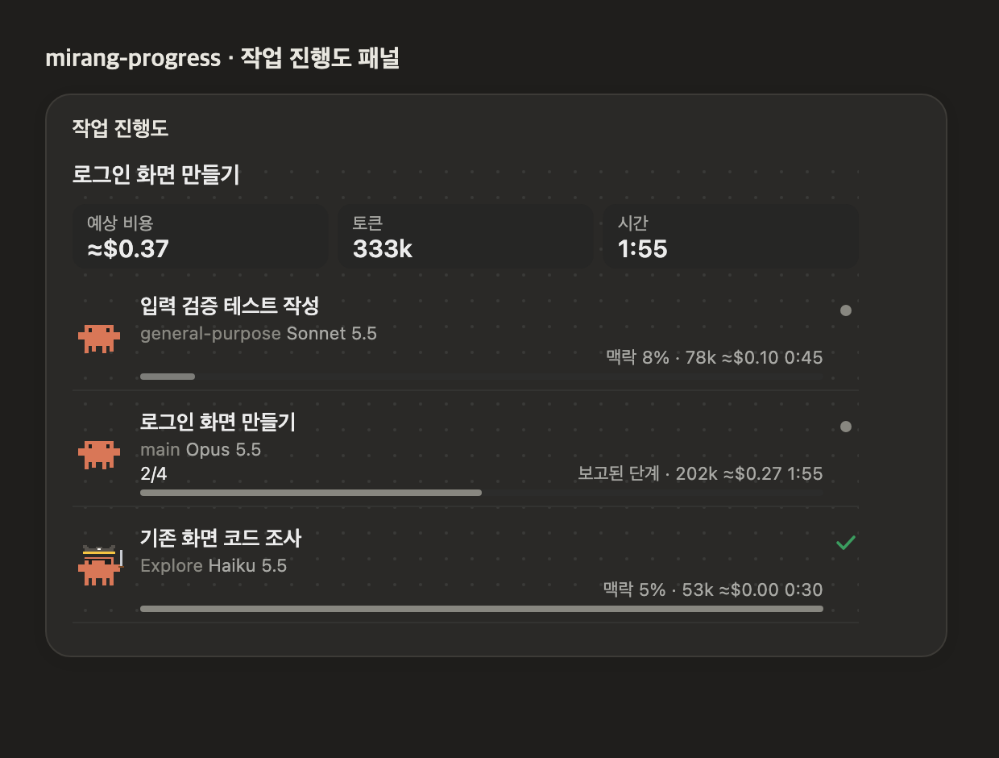

# mirang-mods

Claude Code를 한국어로 보기 좋게 만드는 모드 모음입니다. 필요한 것만 골라 설치할 수 있습니다.

| 모드 | 하는 일 |
|---|---|
| [mirang-usage](mirang-usage) | 입력창 위에 맥락·캐시·요금제 사용량을 한글로 보여 주고, 지금 세션을 계속 써도 되는지 알려 줍니다. |
| [mirang-progress](mirang-progress) | 옆 패널에 작업 진행도와 작업자별 토큰·예상 비용을, 입력창 위에 현재 작업과 픽셀 캐릭터를 보여 줍니다. |

두 모드를 같이 설치하면 입력창 위에 현재 작업 줄이 위, 사용량 띠가 아래로 함께 쌓입니다.



| mirang-usage | mirang-progress |
|---|---|
|  |  |

화면은 예시 작업 데이터로 두 모드가 그린 모습입니다.

## 설치

**터미널의 Claude Code** 프롬프트에서 원하는 것을 입력합니다. 처음 한 번은 마켓플레이스를 추가할지 묻는데, `y`를 누르고 범위는 Enter(사용자 전체)로 고르면 됩니다.

```
/plugin install mirang-usage --marketplace Mirang-93/mirang-mods
/plugin install mirang-progress --marketplace Mirang-93/mirang-mods
```

**셸**에서:

```bash
claude plugin install mirang-usage --marketplace Mirang-93/mirang-mods
claude plugin install mirang-progress --marketplace Mirang-93/mirang-mods
```

**데스크톱 앱**에서는 `/plugin`이 동작하지 않습니다. 프롬프트 옆 **+** → **Plugins** → **Add marketplace**에 `Mirang-93/mirang-mods`를 넣고, 원하는 모드를 **Add plugin**으로 추가하세요. 터미널에서 설치하면 데스크톱 앱에도 같이 적용됩니다.

설치한 뒤 새 세션부터 보입니다.

## 출처와 라이선스

두 모드 모두 MIT 라이선스 모드를 바탕으로 고친 것입니다. 자세한 출처는 각 모드의 README에 있습니다.

- mirang-usage: [Hamza Zafar](https://github.com/hamzafer)의 [claude-code-mods](https://github.com/hamzafer/claude-code-mods)(token-weather, usage-meter, shared/bands.ts)
- mirang-progress: [johnnyvizz](https://github.com/johnnyvizz)의 [savvy-progress](https://github.com/johnnyvizz/claude-kit/tree/main/plugins/savvy-progress)

각 모드 폴더의 LICENSE에 원작자와 Mirang의 저작권 표기가 함께 있습니다.
